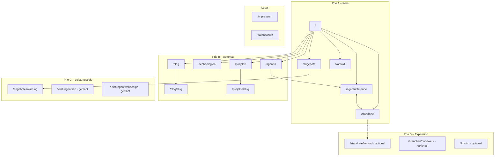

# SEO- & GEO-Strategie Rocketory

**Stand:** August 2026 · **Domain:** [rocketory.de](https://rocketory.de)  
**Entity:** Rocketory (Marke) · FairFlock GmbH (Rechtsträger) · **Ein physischer Standort:** Zimmerstr. 16, 32257 Bünde

---

## Leitprinzipien

1. **Ein HQ, kein Doorway-Spam** – Nur Bünde ist physischer Standort. Umland-Städte = Einsatzgebiet, keine Fake-Büros.
2. **Entity first (GEO)** – Klare, widerspruchsfreie NAP-Daten, zitierbare FAQs, JSON-LD – damit Google & LLMs Rocketory korrekt zuordnen.
3. **Tiefe vor Breite** – Erst Kern-URLs perfektionieren, dann Blog/Projekte, City-Pages erst mit echtem Unique Content.
4. **Conversion neben Rankings** – Jede Prio-A-Seite braucht klaren CTA (Kontakt + WhatsApp).

---

## Prio A – Strategie (Kern-URLs)

Die wichtigsten Seiten für Marken-, Local- und Commercial-Intent. Ohne diese ist keine solide SEO-/GEO-Basis.

### Seiten & Rollen

| URL | Primäre Keywords (Intent) | Rolle |
|-----|---------------------------|-------|
| `/` | Webdesign Bünde, Webdesign OWL, Website Agentur Bünde | Marken-Hub, Leistungsüberblick, Trust |
| `/agentur/buende` | Webdesign Agentur Bünde, Webdesigner Bünde, Webagentur Bünde | **HQ-Entity-Seite** – Stadt, NAP, Geo, FAQ |
| `/standorte` | Webdesign OWL, Webdesign Herford/Bielefeld/Enger … | **Einsatzgebiet-Hub** – 1 Standort, viele Orte |
| `/angebote` | Website erstellen lassen, Webdesign Preise, Website Pakete | Commercial – Leistungen & Pakete |
| `/kontakt` | Webdesign Anfrage, Website Beratung Bünde | Conversion – Formular, NAP, WhatsApp |

### Mindestanforderungen (Prio A)

| Kriterium | Mindeststandard |
|-----------|-----------------|
| **Wörter (sichtbarer Fließtext)** | Start: **≥ 1.200** · Bünde: **≥ 1.400** · Standorte: **≥ 800** · Angebote: **≥ 1.200** · Kontakt: **≥ 400** (+ Formular) |
| **H1** | Einzigartig, Keyword + Ort/Intent, nicht identisch mit `<title>` |
| **Meta Description** | **140–160 Zeichen**, dediziert (nicht Hero-Lead 1:1) |
| **OG/Twitter-Bild** | Standortseiten: `buende-a30.webp` · Start/Angebote: Hero/Team · Kontakt: Cosmos-Bild |
| **Widgets / UI-Module** | Hero · Trust-Bar · Leistungs-Grid/USP · FAQ-Akkordeon · Karte (Embed) · CTA-Block · WhatsApp (Kontakt + Float site-wide) |
| **JSON-LD Schema** | Siehe [Schema-Pflicht pro Seite](#schema-pflicht-prio-a) |
| **NAP (sichtbar)** | Büro: Zimmerstr. 16, 32257 Bünde · Tel. 0160 7624 145 · beratung@rocketory.de · Firmensitz getrennt: Sonnenhügel 16a (Impressum-Link) |
| **Google Maps Embed** | Auf `/agentur/buende` + `/standorte` + `/kontakt` (CMS: `email-settings.googleMapsEmbedUrl`) · `hasMap` in LocalBusiness |
| **CTAs** | Min. 2 pro Seite: primär → `/kontakt`, sekundär → `/angebote` oder WhatsApp |
| **WhatsApp** | Float (site-wide) + expliziter Button auf `/kontakt` · Nummer: `+49 160 7624145` |
| **Interne Links** | Jede Prio-A-Seite verlinkt min. 3 andere Prio-A-URLs + Footer-Nav |
| **Backlinks (Off-page)** | Google Business Profile (GBP) · Branchenverzeichnisse (OWL) · FairFlock/Viralista cross-link · 2–3 lokale Partner/Referenzen mit Follow-Link auf `/agentur/buende` |
| **Bild-Alt-Texte** | Siehe [Alt-Text-Keyword-Guide](#alt-text-keyword-guide) |
| **Sitemap-Priorität** | `/` = 1.0 · `/agentur/buende` + `/standorte` = 0.85 · `/angebote` + `/kontakt` = 0.8 |

### Schema-Pflicht (Prio A)

**Global (layout, alle Seiten):**

```json
{
  "@graph": [
    { "@type": "Organization", "@id": "https://rocketory.de/#organization" },
    { "@type": ["LocalBusiness","ProfessionalService"], "@id": "https://rocketory.de/#localbusiness" },
    { "@type": "WebSite", "@id": "https://rocketory.de/#website" },
    { "@type": "Place", "@id": "https://rocketory.de/agentur/buende#place" },
    { "@type": "ItemList", "@id": "https://rocketory.de/#services" }
  ]
}
```

**LocalBusiness (kanonisch, eine `@id`):**

| Feld | Wert |
|------|------|
| `@id` | `https://rocketory.de/#localbusiness` |
| `name` | Rocketory |
| `legalName` | FairFlock GmbH |
| `address` | Zimmerstr. 16, 32257 Bünde, NRW |
| `telephone` | +491607624145 |
| `email` | beratung@rocketory.de |
| `geo` | 52.1972, 8.5839 |
| `hasMap` | Google Maps Link Zimmerstr. 16 |
| `areaServed` | 13 Städte + OWL + Kreis Herford + NRW |
| `parentOrganization` | → `#organization` |

**Pro Seite zusätzlich:**

| URL | Page-Schema | Zusätzlich |
|-----|-------------|------------|
| `/` | `WebPage` + `BreadcrumbList` | `mainEntity` → LocalBusiness |
| `/agentur/buende` | `AboutPage` + `BreadcrumbList` | `FAQPage`, `Place`, `primaryImageOfPage` |
| `/standorte` | `WebPage` + `BreadcrumbList` | `FAQPage`, `ItemList` (Einsatzgebiet), `Place` |
| `/angebote` | `WebPage` + `BreadcrumbList` | `OfferCatalog` + `Service`-Items |
| `/kontakt` | `ContactPage` + `BreadcrumbList` | `mainEntity` → LocalBusiness |

### Alt-Text Keyword-Guide

Alt-Texte beschreiben **zuerst das Bild**, Keyword **natürlich** einbauen – kein Stuffing.

| Seitentyp | Keyword-Muster (Beispiele) |
|-----------|----------------------------|
| **Startseite** | `Rocketory Team Webdesign Bünde`, `Webdesign Agentur Ostwestfalen` |
| **Bünde-Standort** | `Bünde Ostwestfalen`, `Zigarrenstadt Bünde`, `Rathaus Bünde`, `Webdesign Agentur Bünde` (nur bei Team/Firmenfoto) |
| **Standorte-Hub** | `Einsatzgebiet OWL`, `Webdesign Region Herford` |
| **Angebote** | `Website erstellen`, `Webdesign Paket`, `SEO Betreuung` (passend zum Bildinhalt) |
| **Kontakt** | dekorativ: `alt=""` · Ansprechpartner: Name + Rolle |
| **Blog/Projekte** | `{Projektname} Website`, `{Branche} Referenz {Ort}` |

**Regeln:** Max. ~125 Zeichen · Ort nur wenn bildlich relevant · Kein „Bild von …“ · Personen: Name + Funktion.

### Ist-Stand Prio A (Code, Aug 2026)

| Seite | Wörter (ca.) | Status |
|-------|--------------|--------|
| `/` | ~1.400 | ✅ Live |
| `/agentur/buende` | ~1.500 | ⚠️ Lokal, noch nicht deployed |
| `/standorte` | ~575 | ⚠️ Unter Mindestwortzahl – ausbauen auf ≥800 |
| `/angebote` | ~1.450 | ✅ Live |
| `/kontakt` | ~470 | ✅ Live (Formular ergänzt Conversion) |

---

## Prio B – Autorität & Vertrauen

Seiten abseits der Kern-URLs, die **Topical Authority**, **E-E-A-T** und **Branded Search** stärken.

### Seiten & Keyword-Arten

| URL | Keyword-Typ | Beispiel-Keywords |
|-----|-------------|-------------------|
| `/agentur` | Brand + About + Local (Teaser) | Rocketory Agentur, Webdesign Team Bünde, FairFlock |
| `/technologien` | Tech-Stack + Entscheidungshilfe | WordPress Agentur, Next.js Website, statisches HTML |
| `/blog` | Informational, Long-tail | Webdesign Tipps, lokale SEO, WordPress 2026 |
| `/blog/[slug]` | Long-tail, Problem-Solution | „lokale Website mehr Anfragen“, „WordPress schlank“ |
| `/projekte` | Proof, Branche + Ergebnis | Webdesign Referenzen, Website Projekte OWL |
| `/projekte/[slug]` | Case-Study, Branche + Ort | `{Kunde} Website`, `{Branche} Webdesign` |

### Mindestanforderungen (Prio B)

| Kriterium | Mindeststandard |
|-----------|-----------------|
| **Wörter** | Agentur/Technologien: **≥ 800** · Blog-Post: **≥ 1.000** · Projekt-Case: **≥ 600** |
| **Schema** | Blog: `BlogPosting` + `BreadcrumbList` · Projekt: `CreativeWork`/`Article` · Technologien: `WebPage` + `Service`-Referenzen |
| **Dynamic Content** | Blog + Projekte aus **Payload CMS** (SEO-Snippet-Felder: Titel, Description, OG, noIndex) |
| **Interne Links** | Jeder Blog/Projekt-Post: min. 1 Link zu Prio-A (Angebote/Kontakt/Bünde) · OWL-Erwähnungen → `/standorte` oder `/agentur/buende` |
| **CTA** | Blog/Projekt: Abschluss-CTA → Kontakt · Technologien: Paket-CTA → Angebote |
| **WhatsApp** | Float reicht; in How-to-Artikeln optional Inline-CTA |
| **Backlinks** | Gastbeiträge, Branchenportale, Kunden-Case mit Link zurück |
| **Sitemap-Priorität** | 0.7–0.8 |

### Dynamic Content (Prio B)

| Quelle | Route | Refresh |
|--------|-------|---------|
| Payload `posts` | `/blog/[slug]` | Bei Publish/Update |
| Payload `projects` | `/projekte/[slug]` | Bei Publish/Update |
| Legacy Blog HTML | `/blog/[slug]` | Fallback für statische Artikel |
| Global `homepage` | Featured auf `/` + `/blog` | Manuell im Admin |

### Geplante Blog-Themen (Keyword-Cluster)

- **Local SEO:** lokale Website, Google Maps, NAP, OWL-Sichtbarkeit
- **Technologie:** WordPress vs. Headless, Performance, statisches HTML
- **Business:** Website Kosten, Relaunch, Zusammenarbeit
- **Design:** Limbic Map, Farben, UX für KMU

---

## Prio C – Leistungs-Tiefe & Long-tail

Erweiterung entlang konkreter **Service-Intents** – ohne Doorway-Risiko.

### Seiten (geplant / optional)

| URL (Vorschlag) | Keyword-Typ | Inhalt |
|-----------------|-------------|--------|
| `/angebote#wartung` → `/wartung` (Redirect) | Service | Website-Wartung, Updates, Sicherheit |
| `/leistungen/webdesign` | Service + Local | Webdesign Bünde/OWL (wenn eigene URL sinnvoll) |
| `/leistungen/seo` | Service + Local | SEO Agentur OWL, lokale Sichtbarkeit |
| `/leistungen/hosting` | Service | Hosting & Betreuung nach Launch |
| Blog-Serie „Branche × Web“ | Long-tail | Webdesign Handwerk, Gastronomie, Arztpraxis OWL |

### Mindestanforderungen (Prio C)

| Kriterium | Mindeststandard |
|-----------|-----------------|
| **Wörter** | Service-Landing: **≥ 900** · Branchen-Artikel: **≥ 1.200** |
| **Schema** | `Service` + `Offer` mit `provider` → LocalBusiness · FAQ bei wiederkehrenden Fragen |
| **Unique Content** | Min. 1 Case, 1 FAQ-Block, 1 Prozess-Abschnitt – **kein Copy von Angebote** |
| **Dynamic Content** | Primär Blog/CMS; Service-Pages statisch bis CMS-Anbindung |
| **Interne Links** | Hub → Prio A · Spoke → Angebote-Anker + Kontakt |
| **Sitemap-Priorität** | 0.65–0.75 |

### Keyword-Arten Prio C

- **Transactional long-tail:** „Website Wartung Bünde“, „SEO Betreuung OWL“
- **Branchen-Informational:** „Website für Handwerker“, „Webdesign Friseur“
- **Vergleich:** „WordPress oder statische Website KMU“

---

## Prio D – Expansion (nur mit echtem Mehrwert)

Langfristige Skalierung – **bewusst zurückgestellt**, um Doorway-Penaltys zu vermeiden.

### Seiten (nur bei Unique Content)

| Typ | Beispiel-URLs | Voraussetzung |
|-----|---------------|---------------|
| **City-Pages** | `/webdesign-herford`, `/webdesign-bielefeld` | Je Ort: ≥1.200 Wörter, lokaler Case, eigenes FAQ, **kein** Büro-Faking |
| **Stadt-Unterordner** | `/standorte/herford` | Nur wenn Hub allein nicht reicht + echter Proof |
| **Branchen-Landingpages** | `/branchen/handwerk` | Branchen-Cases + spezifische FAQs |
| **GEO-Assets** | `/llms.txt`, erweiterte `sameAs` (GBP, Wikidata) | GBP stabil, Entity verifiziert |

### Mindestanforderungen (Prio D)

| Kriterium | Mindeststandard |
|-----------|-----------------|
| **Wörter** | City-Page: **≥ 1.200** · Branche: **≥ 1.000** |
| **Schema** | `WebPage` + `Service` · **kein** zweites LocalBusiness · `areaServed` statt Fake-Adresse |
| **NAP** | Immer auf Bünde verweisen · „Betreuung in {Stadt}, Büro in Bünde“ |
| **Dynamic Content** | Cases aus Payload, ggf. Kundenstimmen |
| **Backlinks** | Lokale Presse, IHK, Stadtportale – pro City max. 1–2 qualitativ |
| **Freigabe-Kriterium** | Content-Checkliste: Case ✓ · FAQ ✓ · 0 Duplicate ✓ · intern verlinkt ✓ |

### Was bewusst NICHT gemacht wird

- 13 identische City-Seiten mit nur ausgetauschtem Ortsnamen
- Mehrere Adressen in Schema oder Footer
- Keyword-Spam in Alt-Texten oder unsichtbarem Text

---

## Sitemap

### Visuelle Struktur



### Vollständige URL-Tabelle

| Priorität | URL | changeFreq | priority | Dynamic | Status |
|-----------|-----|------------|----------|---------|--------|
| **A** | `/` | weekly | 1.0 | Featured Posts (Homepage Global) | ✅ Live |
| **A** | `/agentur/buende` | weekly | 0.85 | Maps-Embed (CMS) | ⚠️ Deploy ausstehend |
| **A** | `/standorte` | weekly | 0.85 | — | ⚠️ Deploy + Content ausbauen |
| **A** | `/angebote` | weekly | 0.8 | — | ✅ Live |
| **A** | `/kontakt` | weekly | 0.7 | Formular (API) | ✅ Live |
| **B** | `/agentur` | weekly | 0.8 | — | ✅ Live |
| **B** | `/technologien` | weekly | 0.8 | — | ✅ Live |
| **B** | `/blog` | weekly | 0.8 | Post-Liste (Payload) | ✅ Live |
| **B** | `/blog/[slug]` | monthly | 0.7 | Payload + Legacy | ✅ Live |
| **B** | `/projekte` | weekly | 0.8 | Projekt-Liste (Payload) | ✅ Live |
| **B** | `/projekte/[slug]` | monthly | 0.7 | Payload | ✅ Live |
| **C** | `/angebote#wartung` | weekly | 0.75 | — (Redirect `/wartung` → Anker) | ✅ Live |
| **C** | `/leistungen/*` | monthly | 0.65 | Geplant | 🔲 Offen |
| **D** | `/standorte/[stadt]` | monthly | 0.6 | Geplant | 🔲 Offen |
| **D** | `/branchen/[slug]` | monthly | 0.6 | Geplant | 🔲 Offen |
| **D** | `/llms.txt` | yearly | 0.3 | Geplant | 🔲 Offen |
| **—** | `/impressum` | yearly | 0.3 | — | ✅ Live |
| **—** | `/datenschutz` | yearly | 0.3 | — | ✅ Live |

**Technisch:** `src/app/sitemap.ts` · `src/app/robots.ts` · Canonicals via `buildPageMetadata()`

---

## Einsatzgebiet (areaServed)

Städte im Schema und auf `/standorte` – **Servicegebiet, keine Büros:**

Bünde · Enger · Hiddenhausen · Kirchlengern · Rödinghausen · Löhne · Herford · Bad Oeynhausen · Minden · Lübbecke · Bielefeld · Porta Westfalica · Vlotho

---

## Off-Page & Backlink-Plan (übergreifend)

| Maßnahme | Prio | Ziel-URL |
|----------|------|----------|
| Google Business Profile pflegen | A | `/agentur/buende` |
| `sameAs`: GBP-URL in Organization/LocalBusiness | D | Schema |
| FairFlock.de + Viralista.de → Rocketory | B | `/` oder `/agentur` |
| Lokale Verzeichnisse (OWL, IHK, Handwerk) | B | `/agentur/buende` |
| Kunden-Referenzen mit Follow-Link | B | `/projekte/[slug]` |
| Gastbeiträge / Fachportale | C | `/blog/[slug]` |

---

## Umsetzungs-Roadmap

| Phase | Fokus | Aufwand |
|-------|-------|---------|
| **1 (jetzt)** | Prio A deployen · `/standorte` auf ≥800 Wörter · GBP anlegen | 1–2 Tage |
| **2** | Prio B: Blog/Projekt intern verlinken · sameAs vorbereiten | laufend |
| **3** | Prio C: Service-Landingpages bei Bedarf | 2–4 Wochen |
| **4** | Prio D: City/Branche nur mit Case + Freigabe-Checkliste | quartalsweise |

---

## Referenzen im Code

| Thema | Datei |
|-------|-------|
| Schema-Builder | `src/lib/schema-org/builders.ts` |
| NAP / Städte | `src/lib/schema-org/constants.ts` |
| Metadata / OG | `src/lib/metadata.ts` |
| Sitemap | `src/app/sitemap.ts` |
| CMS SEO-Felder | `src/collections/shared/seoFields.ts` |
| WhatsApp | `src/lib/whatsapp.ts`, `src/components/WhatsAppFloat.tsx` |
| Standort-HTML | `legacy/agentur/buende.html`, `legacy/standorte.html` |
